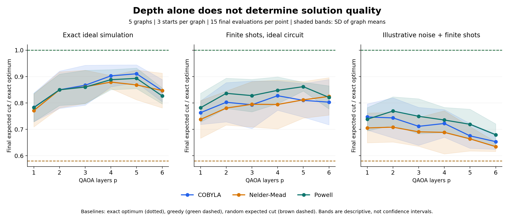
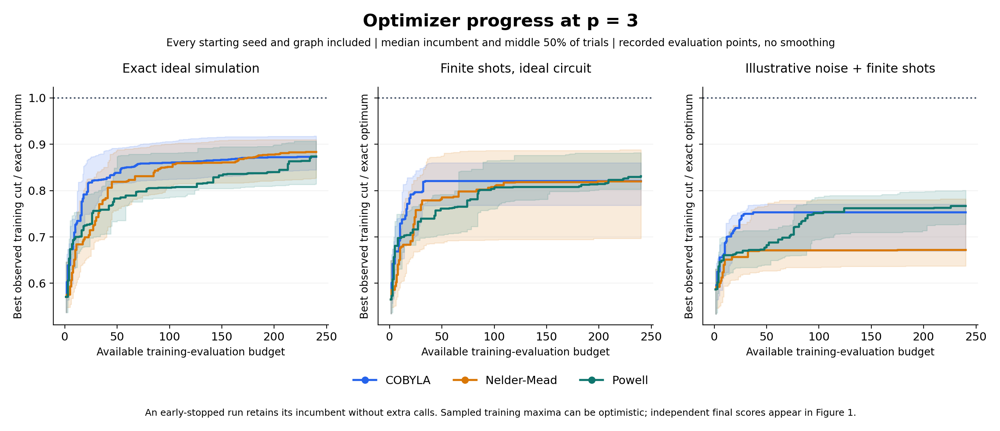
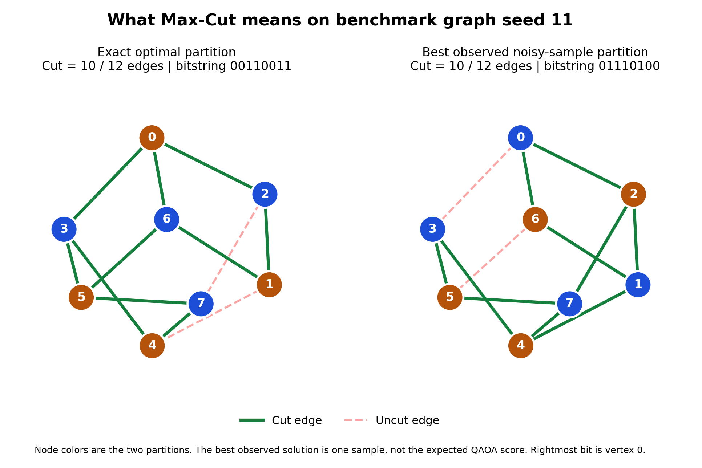
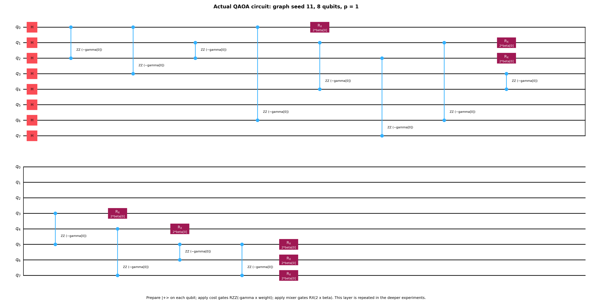
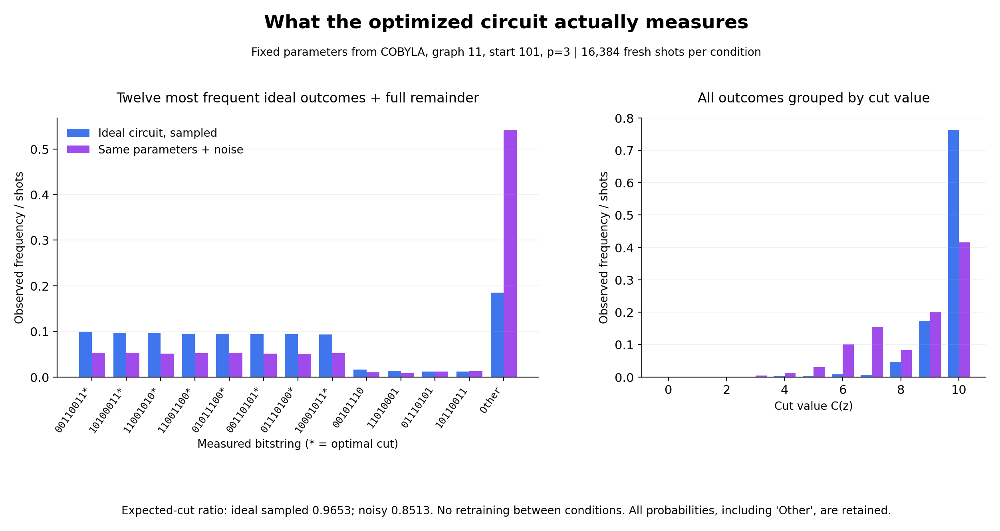
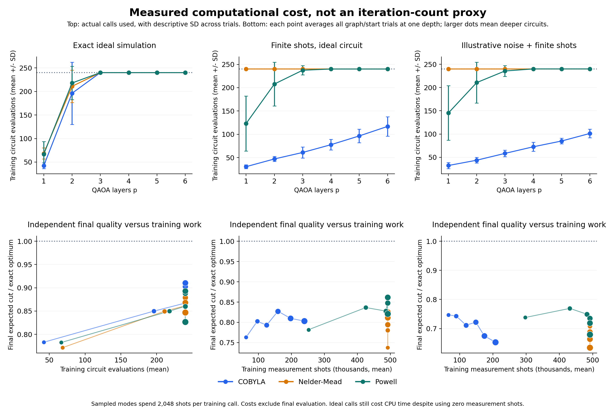
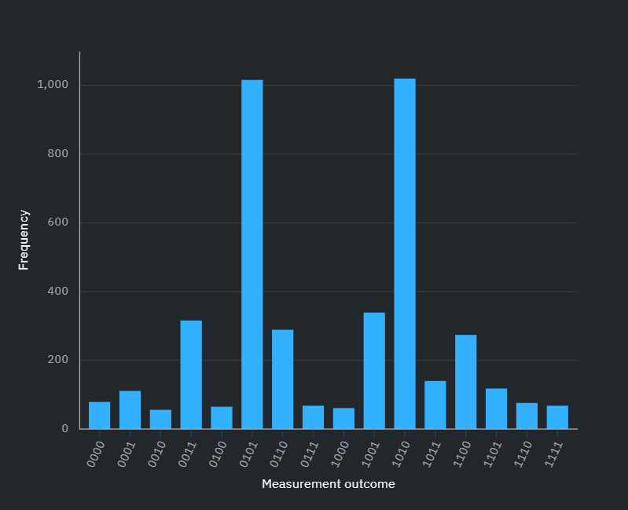
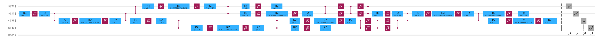

# QAOA Max-Cut: depth, optimization budget, and noise

This project uses the Quantum Approximate Optimization Algorithm (QAOA) to study Max-Cut: splitting a graph into two groups so that as many edges as possible cross between them.

**With a fixed training budget, do more QAOA layers produce better cuts? How do measurement sampling and noise affect the result?**

The quantum circuit produces candidate cuts, and a classical optimizer adjusts its angles to improve the expected cut value. The study compares COBYLA, Nelder-Mead, and Powell with exact brute force, a multistart greedy heuristic, and the expected score of a random cut. You can run it from Python or the VS Code terminal; it needs no GUI or notebook.

## Start in VS Code

Open **this `qaoa-maxcut` folder** as your workspace. Use Python 3.12 or 3.13. In a fresh checkout, run:

```powershell
python -m venv .venv
.\.venv\Scripts\python.exe -m pip install -e ".[dev]"
.\.venv\Scripts\python.exe -m pytest
.\.venv\Scripts\python.exe -m qaoa_maxcut run --config configs/quick.json
```

In VS Code, select `.venv` through **Python: Select Interpreter**. You can then open `examples/run_small.py` and choose **Run Python File**. The example finds the project folder automatically. The commands above use the environment's Python directly, so you do not need to activate it in PowerShell.

On macOS/Linux, replace `.\.venv\Scripts\python.exe` with `.venv/bin/python`.

Start with this quick run. It runs 18 trials: one six-vertex graph, one starting seed, two depths, three optimizers, and three evaluation modes. It helps you check the setup and follow one experiment. The sample is too small for broad conclusions. Each run saves its output in a new timestamped folder under `results/`.

The package versions are pinned in `pyproject.toml`. To use the full tested environment, including optional hardware, figure, and test packages, install `requirements-lock.txt` first, then install the project with `python -m pip install --no-deps -e .`.

## Run the initial study

```powershell
.\.venv\Scripts\python.exe -m qaoa_maxcut run --config configs/study.json --output results/study
```

This runs **243 trials**: three eight-vertex 3-regular graph seeds, three starting seeds, three depths, three optimizers, and three modes. Each optimizer gets at most 80 training evaluations. Sampled modes use 512 shots per evaluation and 4,096 shots for a separate final evaluation. Runtime depends on the machine; start with the quick configuration.

Use a new output folder each time. If `results/study` already exists, choose another name or omit `--output` to create a timestamped folder. If you stop the run, completed trials stay in `results.json`, but the experiment does not resume automatically. You can still make a report from those trials:

```powershell
.\.venv\Scripts\python.exe -m qaoa_maxcut report results/study/results.json
```

## Expanded benchmark and six README figures

The larger benchmark runs **810 trials** across five structurally different eight-qubit graphs, three starts per graph, **six depths (p=1–6)**, three optimizers, and three simulation modes. Each trial allows up to 240 training evaluations. Sampled modes use 2,048 shots per training evaluation and 16,384 shots for a separate final evaluation. A shot is one circuit execution followed by measurement.

This is a small research experiment designed to run on a laptop. Repeated graphs and starts make the comparison more useful, but they do not establish quantum advantage or performance on large industrial problems.

```powershell
.\.venv\Scripts\python.exe -m pip install -e ".[figures]"
.\.venv\Scripts\python.exe -m qaoa_maxcut run --config configs/readme-benchmark.json --workers 4 --output results/readme-benchmark
.\.venv\Scripts\python.exe -m qaoa_maxcut figures --results results/readme-benchmark/results.json --output docs/images
```

See [the experiment design and instructions](docs/figures.md) to repeat the run. The plots below come from actual local Aer simulations. Their data are saved in the [benchmark report](sample_results/readme-benchmark/report.md) and [compressed raw records](sample_results/readme-benchmark/results.json.gz); compression keeps all the original data. [The figure manifest](docs/images/figure-manifest.json) stores file hashes so the source and images can be checked.

The run took about 20 minutes on the laptop used for this study, with 149,778 training evaluations and over 202 million simulated measurement shots. Greedy search found the optimum on all five graphs. COBYLA's ideal mean approximation ratio reached 0.9106 at p=5, then fell at p=6 under the same budget. Noisy results generally got worse as depth increased. Read [the observations and limitations](sample_results/readme-benchmark/observations.md) for context.

### 1. Depth and solution quality



Each point averages 15 trials across graphs and starting seeds. The shaded bands show the standard deviation (SD) of graph means. Final quality is measured separately from training. The horizontal lines show the exact optimum and classical baselines.

### 2. Optimizer convergence



At p=3, each line shows the median best training score found so far; the band shows the middle 50% of trials. The steps come directly from recorded evaluations, without smoothing. If a run stops early, its last best score is carried forward on the plot; no extra evaluations are counted.

### 3. Graph and best observed cut



The two panels show the same graph: first with an exact optimal partition, then with a best cut observed in noisy measurements. Finding one good bitstring does not mean that every measurement produces that score.

### 4. Actual QAOA circuit



Qiskit draws one cost and mixer layer for graph 11. Deeper circuits repeat these layers with their own angles. [Open the SVG circuit diagram](docs/images/04-qaoa-circuit.svg) to zoom in on the gate labels.

### 5. Measurement distribution



This comparison uses the same fixed p=3 angles with and without noise, with 16,384 new shots in each case. The angles were chosen using a fixed graph/start rule, not by searching for the best trial. “Other” groups all outcomes left out of the bitstring panel. The cut-value panel includes every outcome.

### 6. Actual evaluation cost



These plots show how many circuit evaluations and shots training used, alongside the separately measured final quality. Equal evaluation counts do not mean equal execution time: deeper circuits contain more gates.

## What the three modes mean

| Mode | Execution | What it measures |
|---|---|---|
| `ideal` | Aer CPU statevector, exact expectation | Optimization without measurement noise |
| `shots` | Ideal Aer circuit, finite measurement samples | Effect of sampling uncertainty |
| `noisy` | Aer density matrix plus gate/readout errors and finite samples | Effect of an explicit illustrative noise model |

The noise model uses single-qubit depolarization 0.001, two-qubit depolarization 0.01, and symmetric readout error 0.02. These values were chosen for the experiment; they are **not live IBM calibration data**. Circuits are compiled to a fixed gate basis before noise is applied. All local simulations run on the CPU.

## Read the outputs

| File | Contents |
|---|---|
| `results.json` | Configuration, environment, graph edges, baselines, parameters, every evaluation, final measurements, and statuses |
| `runs.csv` | One row per trial, including final approximation ratio, shot error, work performed, and termination status |
| `summary.csv` | Mean quality, sample variance/SD, graph-level variation, and evaluation counts |
| `history.csv` | Actual objective values and best observed training value at each evaluation |
| `approximation-ratio.png` | Depth curves without smoothing; error bars are SD of graph means |
| `report.md` | Readable table and explanation of the experiment |

The main metric is the **approximation ratio = expected cut / exact optimum**. A ratio of 1 is optimal. Dividing by the number of edges gives a different measure because some graphs cannot have every edge in the cut. The best measured bitstring is also saved, but its score is different from the expected score over the full distribution.

Graph seeds choose the graph instances; starting seeds choose the initial angles. `summary.csv` reports variation across all trials and across graph means. Plot bands and error bars show descriptive SD, not confidence intervals. The sampling standard error for each final measurement is reported separately. Different graph seeds can produce isomorphic graphs; the five expanded-benchmark graphs were checked to have different structures.

All three optimizers are derivative-free: they use objective values without an explicitly supplied gradient. This study compares these three methods, rather than every optimizer family. They share the same evaluation cap and can stop early. Actual calls and shots are recorded. More layers do not guarantee a better result when the training budget is limited.

The classical baselines help judge solution quality, and their work counts and timings are saved too. This comparison does **not** demonstrate quantum speedup. Statevector simulation runs on a classical computer, and its memory requirements grow exponentially with qubit count.

## Included example results

Completed runs are saved in `sample_results/`:

- [Expanded README benchmark](sample_results/readme-benchmark/report.md): 810 trials, five structurally different graphs, three starts, and six depths; raw data are gzip-compressed without loss.
- [Initial study report](sample_results/study/report.md): 243 trials across three structurally different graphs and three starting seeds.
- [Quick demonstration](sample_results/quick/report.md): 18 trials on one graph; useful for learning the workflow.
- [Small hardware-training run](sample_results/hardware-training/report.md) and [offline Runtime result](sample_results/hardware-offline.json): the offline result uses a fake-device simulation.
- [Completed IBM hardware job](sample_results/hardware-kingston.json): real measurements from `ibm_kingston`, explained below.

The raw JSON or gzip JSON alongside each report contains the evidence behind its tables. New user experiments go into the ignored `results/` directory.

In the initial 243-trial study, greedy search found the optimum on all three graphs. At p=3, COBYLA's mean approximation ratio was 0.8980 in ideal simulation and 0.7433 with noise. These numbers describe that smaller study. See [its observations](sample_results/study/observations.md) for the comparison and limitations.

## Optional real IBM hardware

For a hardware run, the laptop first optimizes the angles. IBM's quantum processor then runs two circuits: QAOA with those angles, and a uniform-superposition reference that samples random cuts. The optimizer itself stays on the laptop. Follow [the hardware instructions](docs/hardware.md) to test the setup, submit a job, and retrieve its results. You need an IBM account with access to a backend and available runtime allocation.

### Completed real-device experiment: ibm_kingston

Job `db5iv1svf2bc73d00bd0` completed on **11 October 2026**, with a four-vertex cycle, **p=1**, and **4,096 shots per circuit**. Angles were optimized locally and then evaluated on IBM hardware alongside a uniform-superposition reference. The exact maximum cut is 4.

| Condition | Expected cut | Expected cut / optimum |
|---|---:|---:|
| Ideal QAOA simulation | 3.0000 | 0.7500 |
| Real-device QAOA | 2.9224 | 0.7306 |
| Real-device uniform reference | 1.9692 | 0.4923 |

The hardware QAOA mean has a shot standard error of **0.0177 cut units**. **49.71%** of its measurements produced an optimal cut. Its expected score was higher than the hardware random reference and close to the ideal prediction. This is one small hardware experiment; it does not establish quantum advantage or performance on other graphs. Shot standard error measures sampling uncertainty, not calibration drift or all systematic errors.



The downloaded IBM histogram shows QAOA counts; the optimal bitstrings are `0101` and `1010`. Counts total 4,096. The reference circuit's measurements are preserved in the job record.



[Open the full-width SVG](docs/images/08-ibm-kingston-circuit.svg) to inspect gate labels and physical-qubit wiring. The QAOA circuit compiled to depth 43 with 14 CZ gates; the reference compiled to depth 4. Logical p=1 and compiled hardware depth describe different things.

The [saved job record](sample_results/hardware-kingston.json) contains the angles, layout, circuit resources, job metrics, and full counts for both circuits. IBM reported 4 seconds of quantum usage; this does not include time spent waiting in the queue. The two images above were downloaded from the IBM job page. The six earlier figures come from local simulations.

## Repository map

```text
src/qaoa_maxcut/
  problems.py       graph generation and validation
  objective.py      cut scores, Hamiltonian, measurement statistics
  circuits.py       parameterized QAOA circuit
  baselines.py      brute force and greedy search
  noise.py          explicit Aer noise model
  evaluation.py     exact, sampled, and noisy execution
  optimization.py   common budget and three classical optimizers
  experiments.py    seeds, runs, records, and independent final evaluation
  parallel.py       optional process execution with unchanged trial seeds
  data.py           JSON and lossless gzip record reading
  reporting.py      CSV, statistics, and saved plots
  figures.py        six README figures and provenance manifest
  hardware.py       optional IBM Runtime workflow
  cli.py            terminal commands
configs/            quick, initial study, expanded benchmark, hardware
examples/           directly runnable Python example
tests/              numerical correctness and integration checks
sample_results/     completed local experiments and raw records
docs/               concepts, hardware, provenance, verification, figures
changes.md          every major change, its reason, and its validation
```

Use [docs/concepts.md](docs/concepts.md) for a suggested reading order. [changes.md](changes.md) explains what changed and why. [docs/verification.md](docs/verification.md) lists the checks that were actually run. For a study chat, [TEACHING_HANDOFF.txt](TEACHING_HANDOFF.txt) provides a seven-day teaching plan.

## Attribution and scope

This is a new implementation based on the QAOA/Max-Cut study idea in the supplied **Hybrid-Quantum-Classical-Algorithms** project. [docs/provenance.md](docs/provenance.md) explains that starting point and the new implementation. Results, affiliations, and authorship claims from the reference project are not presented as belonging to this project.

An institute license for this new project is pending. No license is assigned here. Third-party libraries retain their own licenses.

## Technical references

- [Original QAOA paper, Farhi, Goldstone, Gutmann](https://arxiv.org/abs/1411.4028)
- [IBM: bit ordering](https://quantum.cloud.ibm.com/docs/en/guides/bit-ordering)
- [Qiskit Aer: noise models](https://qiskit.github.io/qiskit-aer/tutorials/3_building_noise_models.html)
- [SciPy: minimize](https://docs.scipy.org/doc/scipy/reference/generated/scipy.optimize.minimize.html)
- [IBM: SamplerV2](https://quantum.cloud.ibm.com/docs/en/api/qiskit-ibm-runtime/sampler-v2)
