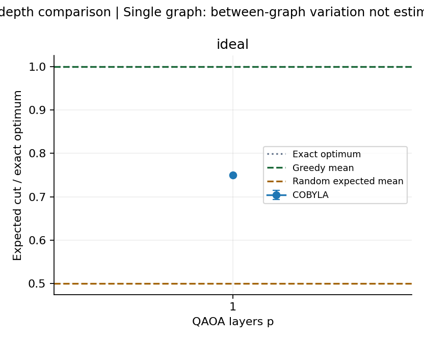

# Experiment results

Experiment status: complete.

Metric: independently evaluated expected cut divided by the exact graph optimum.
Standard deviations and variances describe this finite sample, not universal performance.
Graph means average the starting seeds first; their SD measures between-graph variation.
Trial SD mixes graph and starting-seed variation. Final shot standard errors are separate in runs.csv.
A single graph/seed cannot estimate the corresponding variation (blank CSV values).

Greedy mean ratio: 1.0000. Random-cut expected mean ratio: 0.5000.
Greedy returns one classical solution; QAOA's main metric is an expected solution score.
These are quality baselines, not equal-time demonstrations of quantum advantage.

| Mode | Optimizer | p | Trials | Mean ratio | Trial SD | Mean evaluations |
|---|---|---:|---:|---:|---:|---:|
| ideal | COBYLA | 1 | 1 | 0.7500 | N/A | 36.0 |

The evaluation cap is shared, but optimizers may converge early. Actual evaluation counts are recorded.
An exact expectation and a shot-based circuit execution have different costs; compare modes accordingly.
Final evaluation uses one additional circuit execution and is excluded from the training budget.
No real hardware was involved in these local experiment results.
