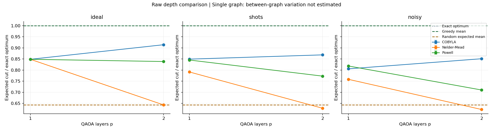

# Experiment results

Experiment status: complete.

Metric: independently evaluated expected cut divided by the exact graph optimum.
Standard deviations and variances describe this finite sample, not universal performance.
Graph means average the starting seeds first; their SD measures between-graph variation.
Trial SD mixes graph and starting-seed variation. Final shot standard errors are separate in runs.csv.
A single graph/seed cannot estimate the corresponding variation (blank CSV values).

Greedy mean ratio: 1.0000. Random-cut expected mean ratio: 0.6429.
Greedy returns one classical solution; QAOA's main metric is an expected solution score.
These are quality baselines, not equal-time demonstrations of quantum advantage.

| Mode | Optimizer | p | Trials | Mean ratio | Trial SD | Mean evaluations |
|---|---|---:|---:|---:|---:|---:|
| ideal | COBYLA | 1 | 1 | 0.8485 | N/A | 40.0 |
| ideal | COBYLA | 2 | 1 | 0.9141 | N/A | 40.0 |
| ideal | Nelder-Mead | 1 | 1 | 0.8485 | N/A | 40.0 |
| ideal | Nelder-Mead | 2 | 1 | 0.6429 | N/A | 40.0 |
| ideal | Powell | 1 | 1 | 0.8485 | N/A | 40.0 |
| ideal | Powell | 2 | 1 | 0.8385 | N/A | 40.0 |
| noisy | COBYLA | 1 | 1 | 0.8055 | N/A | 35.0 |
| noisy | COBYLA | 2 | 1 | 0.8510 | N/A | 40.0 |
| noisy | Nelder-Mead | 1 | 1 | 0.7583 | N/A | 40.0 |
| noisy | Nelder-Mead | 2 | 1 | 0.6223 | N/A | 40.0 |
| noisy | Powell | 1 | 1 | 0.8184 | N/A | 40.0 |
| noisy | Powell | 2 | 1 | 0.7101 | N/A | 40.0 |
| shots | COBYLA | 1 | 1 | 0.8492 | N/A | 31.0 |
| shots | COBYLA | 2 | 1 | 0.8684 | N/A | 40.0 |
| shots | Nelder-Mead | 1 | 1 | 0.7914 | N/A | 40.0 |
| shots | Nelder-Mead | 2 | 1 | 0.6279 | N/A | 40.0 |
| shots | Powell | 1 | 1 | 0.8452 | N/A | 40.0 |
| shots | Powell | 2 | 1 | 0.7727 | N/A | 40.0 |

The evaluation cap is shared, but optimizers may converge early. Actual evaluation counts are recorded.
An exact expectation and a shot-based circuit execution have different costs; compare modes accordingly.
Final evaluation uses one additional circuit execution and is excluded from the training budget.
No real hardware was involved in these local experiment results.
