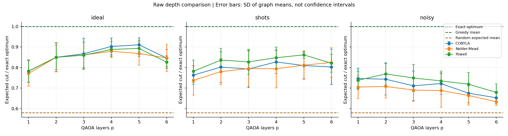

# Experiment results

Experiment status: complete.

Metric: independently evaluated expected cut divided by the exact graph optimum.
Standard deviations and variances describe this finite sample, not universal performance.
Graph means average the starting seeds first; their SD measures between-graph variation.
Trial SD mixes graph and starting-seed variation. Final shot standard errors are separate in runs.csv.
A single graph/seed cannot estimate the corresponding variation (blank CSV values).

Greedy mean ratio: 1.0000. Random-cut expected mean ratio: 0.5800.
Greedy returns one classical solution; QAOA's main metric is an expected solution score.
These are quality baselines, not equal-time demonstrations of quantum advantage.

| Mode | Optimizer | p | Trials | Mean ratio | Trial SD | Mean evaluations |
|---|---|---:|---:|---:|---:|---:|
| ideal | COBYLA | 1 | 15 | 0.7830 | 0.0505 | 42.3 |
| ideal | COBYLA | 2 | 15 | 0.8499 | 0.0728 | 196.2 |
| ideal | COBYLA | 3 | 15 | 0.8671 | 0.0750 | 240.0 |
| ideal | COBYLA | 4 | 15 | 0.9026 | 0.0603 | 240.0 |
| ideal | COBYLA | 5 | 15 | 0.9106 | 0.0519 | 240.0 |
| ideal | COBYLA | 6 | 15 | 0.8464 | 0.0816 | 240.0 |
| ideal | Nelder-Mead | 1 | 15 | 0.7713 | 0.0692 | 68.4 |
| ideal | Nelder-Mead | 2 | 15 | 0.8496 | 0.0680 | 210.9 |
| ideal | Nelder-Mead | 3 | 15 | 0.8613 | 0.0831 | 240.0 |
| ideal | Nelder-Mead | 4 | 15 | 0.8792 | 0.0344 | 240.0 |
| ideal | Nelder-Mead | 5 | 15 | 0.8683 | 0.0736 | 240.0 |
| ideal | Nelder-Mead | 6 | 15 | 0.8470 | 0.0846 | 240.0 |
| ideal | Powell | 1 | 15 | 0.7825 | 0.0500 | 66.8 |
| ideal | Powell | 2 | 15 | 0.8499 | 0.0596 | 218.0 |
| ideal | Powell | 3 | 15 | 0.8603 | 0.0658 | 240.0 |
| ideal | Powell | 4 | 15 | 0.8881 | 0.0436 | 240.0 |
| ideal | Powell | 5 | 15 | 0.8933 | 0.0590 | 240.0 |
| ideal | Powell | 6 | 15 | 0.8265 | 0.0663 | 240.0 |
| noisy | COBYLA | 1 | 15 | 0.7468 | 0.0466 | 32.3 |
| noisy | COBYLA | 2 | 15 | 0.7434 | 0.0760 | 43.7 |
| noisy | COBYLA | 3 | 15 | 0.7114 | 0.0790 | 58.4 |
| noisy | COBYLA | 4 | 15 | 0.7222 | 0.0578 | 72.6 |
| noisy | COBYLA | 5 | 15 | 0.6752 | 0.0556 | 85.0 |
| noisy | COBYLA | 6 | 15 | 0.6533 | 0.0465 | 101.3 |
| noisy | Nelder-Mead | 1 | 15 | 0.7053 | 0.0791 | 240.0 |
| noisy | Nelder-Mead | 2 | 15 | 0.7082 | 0.0866 | 240.0 |
| noisy | Nelder-Mead | 3 | 15 | 0.6905 | 0.0801 | 240.0 |
| noisy | Nelder-Mead | 4 | 15 | 0.6885 | 0.0916 | 240.0 |
| noisy | Nelder-Mead | 5 | 15 | 0.6640 | 0.0698 | 240.0 |
| noisy | Nelder-Mead | 6 | 15 | 0.6343 | 0.0459 | 240.0 |
| noisy | Powell | 1 | 15 | 0.7382 | 0.0515 | 145.3 |
| noisy | Powell | 2 | 15 | 0.7693 | 0.0544 | 210.6 |
| noisy | Powell | 3 | 15 | 0.7494 | 0.0641 | 235.6 |
| noisy | Powell | 4 | 15 | 0.7353 | 0.0610 | 240.0 |
| noisy | Powell | 5 | 15 | 0.7191 | 0.0699 | 240.0 |
| noisy | Powell | 6 | 15 | 0.6794 | 0.0473 | 240.0 |
| shots | COBYLA | 1 | 15 | 0.7631 | 0.0660 | 30.5 |
| shots | COBYLA | 2 | 15 | 0.8026 | 0.0783 | 47.1 |
| shots | COBYLA | 3 | 15 | 0.7931 | 0.0970 | 61.0 |
| shots | COBYLA | 4 | 15 | 0.8274 | 0.0989 | 77.7 |
| shots | COBYLA | 5 | 15 | 0.8098 | 0.0922 | 96.5 |
| shots | COBYLA | 6 | 15 | 0.8031 | 0.1032 | 116.9 |
| shots | Nelder-Mead | 1 | 15 | 0.7375 | 0.0907 | 240.0 |
| shots | Nelder-Mead | 2 | 15 | 0.7806 | 0.0938 | 240.0 |
| shots | Nelder-Mead | 3 | 15 | 0.7950 | 0.1066 | 240.0 |
| shots | Nelder-Mead | 4 | 15 | 0.7942 | 0.1151 | 240.0 |
| shots | Nelder-Mead | 5 | 15 | 0.8118 | 0.1176 | 240.0 |
| shots | Nelder-Mead | 6 | 15 | 0.8249 | 0.0908 | 240.0 |
| shots | Powell | 1 | 15 | 0.7819 | 0.0506 | 123.0 |
| shots | Powell | 2 | 15 | 0.8365 | 0.0586 | 207.8 |
| shots | Powell | 3 | 15 | 0.8278 | 0.0809 | 237.4 |
| shots | Powell | 4 | 15 | 0.8478 | 0.0882 | 240.0 |
| shots | Powell | 5 | 15 | 0.8618 | 0.0680 | 240.0 |
| shots | Powell | 6 | 15 | 0.8211 | 0.0819 | 240.0 |

The evaluation cap is shared, but optimizers may converge early. Actual evaluation counts are recorded.
An exact expectation and a shot-based circuit execution have different costs; compare modes accordingly.
Final evaluation uses one additional circuit execution and is excluded from the training budget.
No real hardware was involved in these local experiment results.
