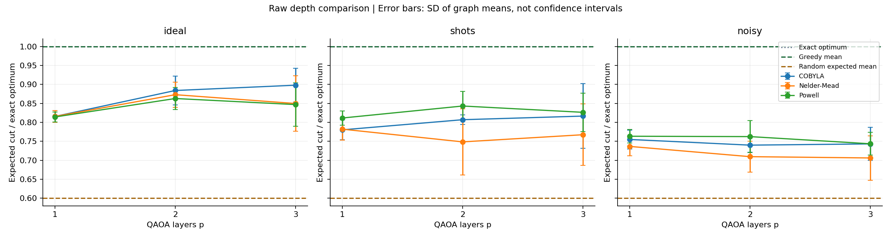

# Experiment results

Experiment status: complete.

Metric: independently evaluated expected cut divided by the exact graph optimum.
Standard deviations and variances describe this finite sample, not universal performance.
Graph means average the starting seeds first; their SD measures between-graph variation.
Trial SD mixes graph and starting-seed variation. Final shot standard errors are separate in runs.csv.
A single graph/seed cannot estimate the corresponding variation (blank CSV values).

Greedy mean ratio: 1.0000. Random-cut expected mean ratio: 0.6000.
Greedy returns one classical solution; QAOA's main metric is an expected solution score.
These are quality baselines, not equal-time demonstrations of quantum advantage.

| Mode | Optimizer | p | Trials | Mean ratio | Trial SD | Mean evaluations |
|---|---|---:|---:|---:|---:|---:|
| ideal | COBYLA | 1 | 9 | 0.8156 | 0.0131 | 41.0 |
| ideal | COBYLA | 2 | 9 | 0.8840 | 0.0345 | 79.0 |
| ideal | COBYLA | 3 | 9 | 0.8980 | 0.0401 | 80.0 |
| ideal | Nelder-Mead | 1 | 9 | 0.8156 | 0.0131 | 63.8 |
| ideal | Nelder-Mead | 2 | 9 | 0.8729 | 0.0315 | 80.0 |
| ideal | Nelder-Mead | 3 | 9 | 0.8497 | 0.0856 | 80.0 |
| ideal | Powell | 1 | 9 | 0.8142 | 0.0117 | 63.2 |
| ideal | Powell | 2 | 9 | 0.8629 | 0.0339 | 80.0 |
| ideal | Powell | 3 | 9 | 0.8469 | 0.0867 | 80.0 |
| noisy | COBYLA | 1 | 9 | 0.7550 | 0.0610 | 29.2 |
| noisy | COBYLA | 2 | 9 | 0.7400 | 0.0433 | 41.9 |
| noisy | COBYLA | 3 | 9 | 0.7433 | 0.0428 | 54.6 |
| noisy | Nelder-Mead | 1 | 9 | 0.7366 | 0.0719 | 80.0 |
| noisy | Nelder-Mead | 2 | 9 | 0.7096 | 0.0838 | 80.0 |
| noisy | Nelder-Mead | 3 | 9 | 0.7062 | 0.0871 | 80.0 |
| noisy | Powell | 1 | 9 | 0.7634 | 0.0437 | 77.3 |
| noisy | Powell | 2 | 9 | 0.7625 | 0.0644 | 80.0 |
| noisy | Powell | 3 | 9 | 0.7436 | 0.0493 | 80.0 |
| shots | COBYLA | 1 | 9 | 0.7803 | 0.0729 | 29.6 |
| shots | COBYLA | 2 | 9 | 0.8070 | 0.0316 | 41.8 |
| shots | COBYLA | 3 | 9 | 0.8165 | 0.0881 | 60.7 |
| shots | Nelder-Mead | 1 | 9 | 0.7821 | 0.0712 | 80.0 |
| shots | Nelder-Mead | 2 | 9 | 0.7486 | 0.1173 | 80.0 |
| shots | Nelder-Mead | 3 | 9 | 0.7674 | 0.1219 | 80.0 |
| shots | Powell | 1 | 9 | 0.8115 | 0.0175 | 75.4 |
| shots | Powell | 2 | 9 | 0.8431 | 0.0396 | 80.0 |
| shots | Powell | 3 | 9 | 0.8265 | 0.0803 | 80.0 |

The evaluation cap is shared, but optimizers may converge early. Actual evaluation counts are recorded.
An exact expectation and a shot-based circuit execution have different costs; compare modes accordingly.
Final evaluation uses one additional circuit execution and is excluded from the training budget.
No real hardware was involved in these local experiment results.
